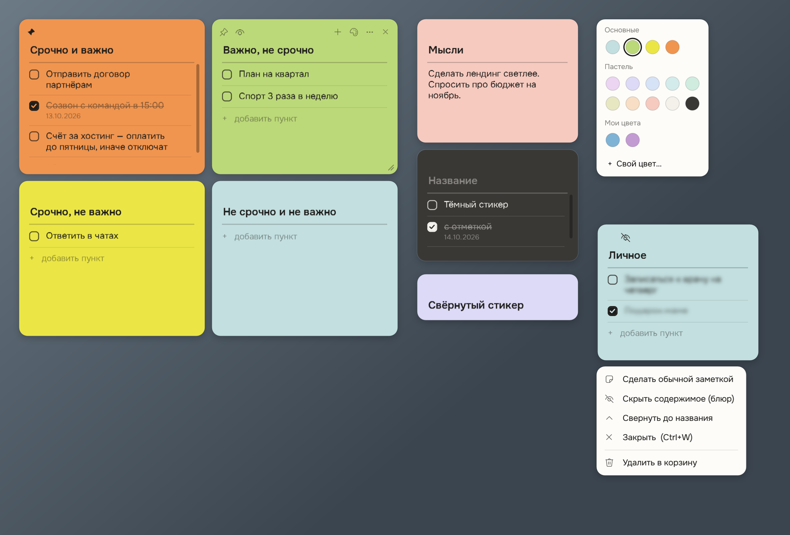

# Desktop Stickers

Lightweight sticky notes for the Windows desktop: checklists, an Eisenhower-matrix template, completion dates and a privacy blur for personal tasks.
It is a single ~480 KB `.exe` with nothing to install.



> **Interface language:** the app UI is in Russian. This README gives English translations of every button and menu item.

## Features

- **Free-floating stickers.** Drag a sticker by its top bar. It snaps to neighbouring stickers with an even 10 px gap and to screen edges, so a neat 2×2 matrix takes seconds. Hold <kbd>Alt</kbd> while dragging to turn snapping off.
- **Checklists or plain notes**, each with its own editable title. You can switch a sticker between the two modes at any time without losing content.
- **Completion dates.** Checking an item writes a small, muted date (`dd.mm.yyyy`) under it. Unchecking the item removes the date.
- **Templates:**
  - *Eisenhower matrix*: 4 stickers (urgent & important, important & not urgent, and so on) laid out in a 2×2 grid.
  - *Brain dump*: 12 stickers (call, email, message, today, appointments, follow up, soon, schedule, research, wins, buy, thoughts).
- **Pin on top.** A pinned sticker stays above all other windows.
- **Privacy blur.** Blurs every item on a sticker while the title stays visible. Rest the mouse on an item for half a second, or click into it, to read it. This is handy during screen sharing.
- **Close without deleting.** Closed stickers can be reopened from the tray menu. Deleted stickers go to a trash you can restore from.
- **Collapse** a sticker to just its title.
- **Colors:** 4 default colors, 10 pastels and any custom color.
- **Starts with Windows** and restores every sticker where you left it. Everything is saved automatically.
- **Native and light.** Built on WPF and .NET Framework 4.8, which ships with Windows 10 and 11. No runtime, installer or Electron.

## Install

1. Download `Stickers.exe` from the [Releases](../../releases) page.
2. Put it in a **permanent folder you own**, for example `Documents\Stickers`. The app keeps its data in a `data` folder next to the exe, so do not use `Program Files` and do not move the folder later.
3. Double-click `Stickers.exe`.
   The exe is not code-signed, so Windows SmartScreen may show *"Windows protected your PC"*. Click **More info → Run anyway**.
4. A welcome sticker appears, and a four-square icon shows up in the system tray. If the icon is hidden, click the `^` arrow next to the clock.

**Requirements:** Windows 10 or 11 (.NET Framework 4.8 is built in).

## Using it

### Sticker toolbar

The buttons appear when you hover over a sticker.

| Button | Action |
| --- | --- |
| Pin (left) | Keep the sticker above all windows |
| Eye (left) | Blur the content (privacy) |
| `+` | New sticker next to this one |
| Palette | Change the color |
| `⋯` | Menu: checklist ↔ plain note, blur, collapse, close, move to trash |
| `×` | Close without deleting |
| Corner grip | Resize |

### Keyboard and mouse

| Shortcut | Action |
| --- | --- |
| <kbd>Enter</kbd> | New item (splits the item at the caret) |
| <kbd>Shift</kbd>+<kbd>Enter</kbd> | Line break inside an item |
| <kbd>Ctrl</kbd>+<kbd>Enter</kbd> | Check / uncheck the item |
| <kbd>Alt</kbd>+<kbd>↑</kbd> / <kbd>↓</kbd> | Move the item up / down |
| <kbd>↑</kbd> / <kbd>↓</kbd> | Jump between items and the title |
| <kbd>Backspace</kbd> at the start of an item | Merge it into the previous item |
| <kbd>Delete</kbd> at the end of an item | Merge the next item into it |
| <kbd>Ctrl</kbd>+<kbd>N</kbd> | New sticker next to the current one |
| <kbd>Ctrl</kbd>+<kbd>W</kbd> | Close the sticker (not deleted) |
| Double-click the top bar | Collapse / expand |
| Right-click the top bar | Open the `⋯` menu |
| <kbd>Alt</kbd> while dragging or resizing | Turn snapping off |

### Tray menu

Left-click the tray icon to bring all stickers to the front. Right-click it for the menu:

| Russian label | Meaning |
| --- | --- |
| Новый стикер | New sticker |
| Матрица Эйзенхауэра (4 стикера) | Eisenhower matrix (4 stickers) |
| Brain dump (12 стикеров) | Brain dump (12 stickers) |
| Показать все стикеры | Show all stickers |
| Закрытые стикеры | Closed stickers (reopen one or all) |
| Корзина | Trash (restore deleted stickers, empty trash) |
| Запускать вместе с Windows | Start with Windows (on by default) |
| Открыть папку с данными | Open the data folder |
| Выход | Exit |

## Data, autostart and uninstalling

- **Data** is stored in `data\notes.json` next to `Stickers.exe`, with a backup copy next to it. Saving happens about half a second after every change.
- **Autostart** uses a per-user Task Scheduler task named `Stickers` with an "at log on" trigger. The *Start with Windows* tray item creates or removes it. No administrator rights are needed.
- **Uninstall:** untick *Start with Windows* in the tray menu, choose *Exit*, then delete the folder.

<details>
<summary>Why not AppData and the registry <code>Run</code> key?</summary>

When an app is launched from inside a packaged (MSIX) app, Windows redirects that process's writes to `%APPDATA%` and `HKCU\Software` into the package's private copy. The app works, but its data and the `Run` entry are invisible to Windows at the next sign-in. Keeping data next to the exe and using Task Scheduler avoids this.
</details>

## Building from source

There is nothing to install: the build uses the C# compiler that ships with .NET Framework 4.8.

```powershell
powershell -ExecutionPolicy Bypass -File build.ps1
```

This produces `Stickers.exe` in the project folder, with the fonts and icon embedded. If the app is running, the script asks it to save and exit first.

The language level is C# 5, because that is what the built-in `csc.exe` supports. Avoid `$"..."` strings, `?.` and expression-bodied members.

### Command-line options

| Option | Purpose |
| --- | --- |
| `--data <folder>` | Use another data folder. Autostart is left untouched. |
| `--selftest --data <folder>` | Run the checklist and persistence self-test. Results go to `<folder>\log.txt`. |
| `--snapshot <file.png> --data <folder>` | Render sample stickers to a PNG without showing windows. This is how `docs/screenshot.png` is made. |
| `--exit` | Ask the running instance to save and quit. |

### Project structure

```
src/
  Program.cs        app start, tray menu, templates, autostart, snapshot mode
  StickerWindow.cs  one sticker window: toolbar, checklist, blur, drag and resize
  Theme.cs          palette, font loading, XAML styles, color and "⋯" popups, snapping
  Model.cs          notes model and JSON storage
  SelfTest.cs       --selftest
fonts/              Onest font (SIL OFL 1.1), embedded into the exe
assets/             app icon
tools/make-icon.ps1 regenerates the icon
build.ps1           build script
```

## Credits

- Font: [Onest](https://github.com/googlefonts/onest), © The Onest Project Authors, [SIL Open Font License 1.1](fonts/OFL.txt). If the commercial font *TT Fors* is installed, the app uses it instead.
- Icons: Segoe Fluent Icons, a Windows system font. It is not bundled.
- The sticker layout and pastel colors were inspired by printable "ADHD brain dump" planners.

## License

The code is released under the [MIT License](LICENSE). The bundled font keeps its own license ([OFL](fonts/OFL.txt)).
